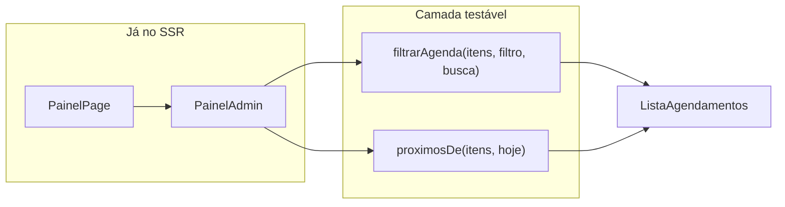

# Acessibilidade, painel intérprete e Tailwind Design

**Spec**: `.specs/features/a11y-painel-tailwind/spec.md`
**Status**: Approved (approach locked by context + AD-001)
**Constraints**: AD-001 Ponytail — menor diff; reuso; sem lib além do runner de teste escolhido

---

## Architecture Overview

Três frentes no mesmo app Next.js, sem novos endpoints:

1. **A11Y** — ajustes pontuais em páginas/componentes existentes (headings, landmarks, `alt`, labels, `role="alert"`).
2. **ADM** — lógica de filtro/busca/próximos em funções puras testáveis + UI no `PainelAdmin` (client se precisar de estado de filtro).
3. **TW** — trocar classes legadas nos TSX que ainda as usam por Tailwind/shadcn; apagar CSS morto em `globals.css`.

**Where the rules run:** `filtrarAgenda` / `proximosDe` (ou equivalentes) em `src/lib/` — a UI só despacha estado; totais ADM-07 usam a lista completa, não a filtrada.

---

## Code Reuse

| Existente | Uso |
| --------- | --- |
| `PainelAdmin`, `ListaAgendamentos`, `Empty`, `Table`, `Card`, `Badge` | Painel |
| `hojeISO`, `ItemAgendamento` | Filtros |
| `slidesCarrossel[].alt`, `CarrosselImagens` | Alts |
| shadcn `Button`, `Input`, `Field`, `Alert` | Auth/contato + erros |
| `AreaLogada` | Heading hierarchy áreas logadas |
| Tokens `:root` / `@theme` | Manter |

---

## Components

| Piece | Location | Change |
| ----- | -------- | ------ |
| `filtrarAgenda` + `proximosDe` | `src/lib/agendamento.ts` (ou arquivo irmão mínimo) | Novas funções puras |
| `PainelAdmin` | `src/components/painelAdmin.tsx` | Client island se filtro/busca; seção Próximos; controles |
| `CarrosselImagens` | `src/components/carrosselImagens.tsx` | `alt={slide.alt}`; live já usa alt |
| `AreaLogada` + auth forms + home | existentes | Marca ≠ `h1`; título da página = `h1` |
| Entrar/Cadastro/Contato | TSX listados no context | Remover classes legadas |
| `globals.css` | `src/app/globals.css` | Delete regras órfãs |

---

## Data Models

Sem schema/API novos. Tipos já existentes: `ItemAgendamento`, `ClienteResumo`, `SlideCarrossel`.

Filtro UI: `'hoje' | 'proximos' | 'todos'`. Busca: string trim + includes case-insensitive em `nome`/`email`.

---

## Error Handling

Sem novas falhas de rede. Erros de form: `role="alert"` ou `aria-live="assertive"` nos feedbacks existentes (A11Y-06).

---

## Risks & Concerns

| Concern | Mitigation |
| ------- | ---------- |
| `PainelAdmin` vira client e perde SSR dos cards | Só o bloco interativo vira client; ou o componente inteiro client com props serializadas (já é o padrão de `ContaCliente`) |
| CSS morto apagado demais | Grep das classes antes/depois; build visual smoke nas rotas auth |
| Sem runner de teste hoje | Tasks pedem confirmação do runner antes de Execute |
| Hierarquia h1 na home vs logo | Home: h1 no hero; logo é link/`span`, não heading |

---

## Ponytail skips (explicit)

- Não extrair design system
- Não refatorar home além de a11y pontual
- Não adicionar URL state nos filtros
- Não e2e browser a menos que o usuário peça
