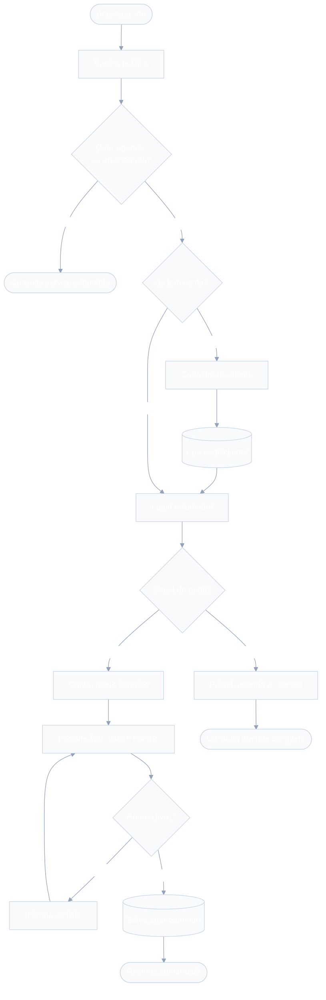

# Fluxograma do sistema — Libras Interprete

Material para a documentação do Projeto Integrador (PI). Descreve o fluxo geral de uso: visitante, autenticação, papéis e agendamento.

## Objetivo do fluxo

Mostrar como o usuário percorre a aplicação desde a página pública até a área autenticada, e como o sistema decide entre a área do **cliente** (`/conta`) e a do **intérprete** (`/painel`), incluindo a criação de uma reserva.

## Diagrama

Arquivos para colar no PI:

- Fonte Mermaid: [`diagramas/fluxograma-sistema.mmd`](./diagramas/fluxograma-sistema.mmd)
- Imagem PNG: [`diagramas/fluxograma-sistema.png`](./diagramas/fluxograma-sistema.png)
- Imagem SVG: [`diagramas/fluxograma-sistema.svg`](./diagramas/fluxograma-sistema.svg)

## Descrição das etapas

1. **Acesso público** — o visitante vê serviços, carrossel e contato sem login.
2. **Necessidade de autenticação** — agendar ou abrir área logada exige conta.
3. **Cadastro** — cria usuário no Neon Auth e perfil `cliente` na tabela `perfis`.
4. **Login** — sessão validada; o papel do perfil define o destino.
5. **Cliente** — em `/conta`, escolhe tipo/data/horário; a API rejeita conflito de faixa.
6. **Intérprete** — em `/painel`, consulta a agenda e o resumo de clientes (sem criar reserva pela API pública de agendamento).

## Decisões importantes no fluxo

| Decisão | Critério | Resultado |
| --- | --- | --- |
| Precisa autenticar? | Quer agendar ou área logada | Segue para cadastro/login |
| Papel | `cliente` ou `interprete` | `/conta` ou `/painel` |
| Horário livre? | Sem sobreposição na mesma data | Salva ou pede outro intervalo |

## Endpoints envolvidos

| Rota | Papel no fluxo |
| --- | --- |
| `/` | Entrada pública |
| `/cadastro` | Criação de conta cliente |
| `/entrar` | Login |
| `/conta` | Área do cliente |
| `/painel` | Área do intérprete |
| `/api/agendamento` | Lista slots ocupados (GET) e cria reserva (POST, só cliente) |
| `/api/auth/[...path]` | Autenticação Neon Auth |
