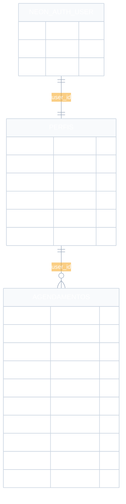

# Modelo de banco de dados — Libras Interprete

Material para a documentação do Projeto Integrador (PI). Reflete o schema em `src/db/schema.ts` (Neon Postgres + Drizzle ORM) e a autenticação gerenciada pelo Neon Auth.

## Visão geral

O sistema persiste dois conjuntos de dados de aplicação:

| Entidade | Tabela | Função |
| --- | --- | --- |
| Perfil | `perfis` | Liga o usuário autenticado ao papel na aplicação (`cliente` ou `interprete`) |
| Agendamento | `agendamentos` | Reserva de interpretação em Libras (tipo, data, horário e contato) |

A identidade de login (e-mail, senha/sessão) fica no **Neon Auth** (`neon_auth.user`). A aplicação guarda apenas o `user_id` dessa identidade.

## Diagrama entidade-relacionamento (ER)

Arquivos para colar no PI:

- Fonte Mermaid: [`diagramas/modelo-bd-erd.mmd`](./diagramas/modelo-bd-erd.mmd)
- Imagem PNG: [`diagramas/modelo-bd-erd.png`](./diagramas/modelo-bd-erd.png)
- Imagem SVG: [`diagramas/modelo-bd-erd.svg`](./diagramas/modelo-bd-erd.svg)

## Relacionamentos

| Relação | Cardinalidade | Descrição |
| --- | --- | --- |
| Neon Auth User → Perfis | 1:1 | Cada usuário autenticado possui um perfil de aplicação (`user_id` único) |
| Perfis → Agendamentos | 1:N | Um cliente pode ter vários agendamentos; cada reserva pertence a um `user_id` |

Regra de negócio adicional: o par `(data, horario)` é **único** em `agendamentos` — o mesmo intervalo não pode ser reservado duas vezes.

## Dicionário de dados

### `perfis`

| Atributo | Tipo | Nulo | Observação |
| --- | --- | --- | --- |
| `id` | serial | não | Chave primária |
| `user_id` | text | não | Único; referência lógica ao usuário do Neon Auth |
| `email` | text | não | Único |
| `nome` | text | não | Nome exibido na aplicação |
| `papel` | text | não | `cliente` (padrão no cadastro) ou `interprete` |
| `created_at` | timestamptz | não | Data/hora de criação (padrão: agora) |

### `agendamentos`

| Atributo | Tipo | Nulo | Observação |
| --- | --- | --- | --- |
| `id` | serial | não | Chave primária |
| `user_id` | text | não | Cliente autenticado que fez a reserva |
| `tipo` | text | não | Ex.: curso/palestra, consulta médica, reunião, evento |
| `data` | date | não | Dia da interpretação |
| `horario` | text | não | Faixa horária (ex.: `08:00-09:00`) |
| `nome` | text | não | Nome do solicitante (da conta) |
| `email` | text | não | E-mail do solicitante (da conta) |
| `telefone` | text | sim | Contato opcional |
| `observacoes` | text | sim | Detalhes opcionais do pedido |
| `created_at` | timestamptz | não | Data/hora de criação |

**Restrição:** `UNIQUE (data, horario)`.

## Papéis e uso dos dados

| Papel | Origem | Uso no banco |
| --- | --- | --- |
| `cliente` | Cadastro público | Cria linhas em `agendamentos` com o próprio `user_id` |
| `interprete` | Promoção no banco / admin Neon Auth | Lê a agenda e o resumo de clientes; não cria reservas pela API |

## Stack de persistência

- **SGBD:** PostgreSQL (Neon)
- **ORM / migrações:** Drizzle ORM (`src/db/schema.ts`, pasta `drizzle/`)
- **Autenticação:** Neon Auth (Better Auth) — fora do schema de aplicação
